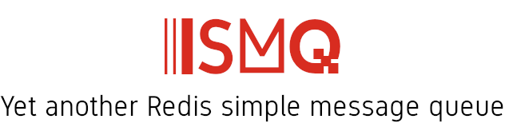
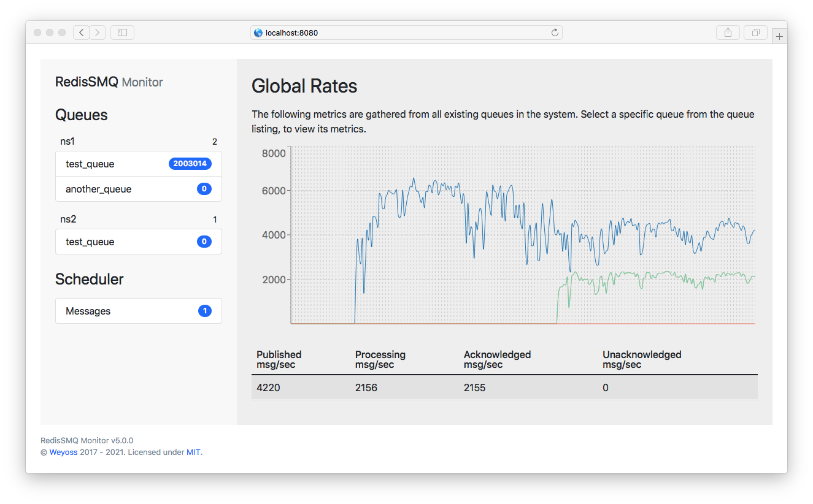

  

  
A simple high-performance Redis message queue for Node.js.

> **Important Notice**
>
> This repository has been archived and is no longer maintained. The RedisSMQ Monitor functionality has been moved to the main [redis-smq repository](https://github.com/weyoss/redis-smq). Please refer to the main repository for the latest updates and documentation.
>
> **What this means:**
>
> - No further issues or pull requests will be accepted in this repository
> - All future updates and improvements will be made in the main redis-smq repository
> - Please direct all questions and contributions to the main repository

# RedisSMQ Monitor Client

    
    

RedisSMQ Monitor Client is a Web UI for the [RedisSMQ Monitor](https://github.com/weyoss/redis-smq-monitor) application. 

From your browser, it allows you to manage RedisSMQ in real-time. The Web UI is shipped with the `redis-smq-monitor` 
package. To start using it, you need to install and configure the [RedisSMQ Monitor](https://github.com/weyoss/redis-smq-monitor).

[More screenshots can be found here](./screenshots).

## License

[MIT](https://github.com/weyoss/redis-smq-monitor-client/blob/master/LICENSE)